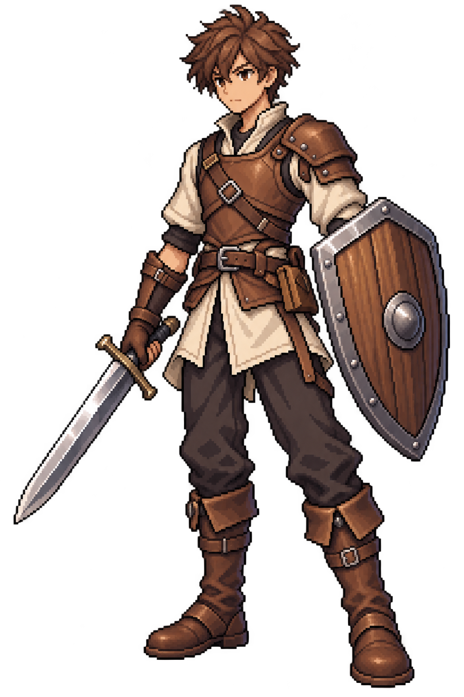

# 캐릭터 일러스트 스타일 기준

확정일: 2026-10-26

## 승인된 기준 이미지

- 확정 파일: `Assets/_Project/Art/Characters/StarterBoy/starter-boy-standing-approved.png`
- 사용자가 등신과 얼굴 수정을 요청한 뒤 생성한 두 장 중 **첫 번째**를 선택했다. 얼굴을 추가로 사실적으로 수정하기 전 이미지다.
- 생성 원본 식별자: `exec-46a8b68d-e822-49d5-952c-1630f9d43045.png`.
- 기존 `starter-boy-standing-v1.png`와 `starter-boy-standing-v2.png`는 비교용 이전 시안이며, 승인된 기준 이미지는 위 `approved` 파일이다.
- 1024 × 1536 PNG, 알파 채널 포함. 게임 화면 연결 및 임포트 설정은 별도 작업이다.

## 앞으로 적용할 방향

새 캐릭터를 만들 때 승인 이미지를 직접 확인하고 시각적 스타일 참조로 사용한다. 아래 문구보다 승인 이미지의 실제 표현과 이후 사용자 지시를 우선한다.

- 원래 첫 시안보다 머리가 작고 팔다리가 길어진 전신 비율. 극단적인 장신이나 치비 비율은 피한다.
- 소년다운 부드러운 얼굴과 절제된 스타일화를 유지한다. 승인본에 남아 있는 약한 아니메 느낌은 허용하며, 추가 수정본처럼 눈을 과도하게 줄이거나 코와 턱을 사실적으로 강조하지 않는다.
- 선명한 어두운 외곽선, 눈에 보이는 픽셀 단위의 윤곽과 단계적인 명암, 가죽·천·금속의 구분이 읽히는 디테일을 따른다.
- 차분한 판타지 색감과 읽기 쉬운 실루엣을 유지하되, 각 캐릭터의 색상·의상·무기는 해당 요청에 맞춘다.
- 머리부터 발끝과 장비까지 온전히 보이는 전신 스탠딩 구성, 약한 3/4 시점과 자연스러운 준비 자세를 기본으로 한다.
- 배경은 투명하게 하고 문자·UI·바닥·배경 장면은 별도 요청이 있을 때만 추가한다.

## 기본 캐릭터 디자인

갈색 짧은 머리의 소년 모험가. 밝은 천 튜닉 위에 가벼운 갈색 가죽 갑옷, 어두운 바지, 가죽 장갑과 부츠를 착용하고 평범한 강철 검과 금속 테두리 나무 방패를 하나씩 든다. 시작 캐릭터다운 소박한 장비를 유지한다.

## 생성 기록

내장 이미지 생성 도구로 제작했다. 승인 이미지는 `starter-boy-standing-v2.prompt.md`의 **Initial revision prompt** 결과다. 같은 문서의 **Final facial refinement prompt** 결과는 선택되지 않았다. 향후 프롬프트의 얼굴 표현이 승인 이미지와 충돌하면 승인 이미지의 표현을 따른다.
