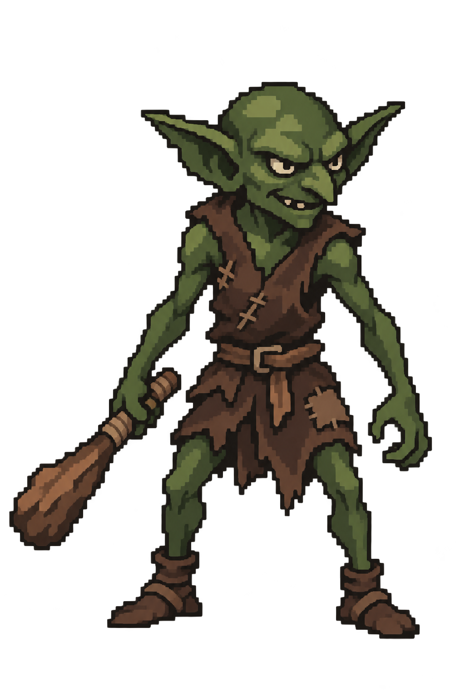

# 몬스터 일러스트 제작·저장 기준

확정일: 2026-11-05.

## 승인된 스타일 기준

- 기준 이미지: `Assets/_Project/Art/Monsters/Goblin/goblin-standing-approved.png`.
- 사용자가 선택한 이미지는 고블린 제작 중 **첫 번째 시안**이다. 도트를 세밀하게 만든 이후 두 보정 결과가 아니다.
- 일반 몬스터는 승인된 고블린처럼 큼직하고 읽기 쉬운 도트, 간결한 내부 색면과 단계적인 명암을 사용한다. 알렌·세레나만큼 작고 촘촘한 도트로 맞출 필요가 없다.
- 플레이어와 판타지 색감·재질·전신 스탠딩 표현은 어울리게 유지하되, 일반 몬스터의 간결한 도트 표현을 불완전한 결과로 판단해 자동으로 세밀하게 보정하지 않는다.
- 보스 등을 플레이어 수준의 고밀도 도트로 제작할 때는 사용자가 먼저 명시한다. 보스·정예 분류만 보고 고밀도 작업을 추론하지 않는다.
- 새 일반 몬스터 작업 전에 고블린 확정본을 직접 확인하고 주 스타일 참조로 사용한다. 몬스터별 체형·장비·표정은 개별 디자인 요청을 따른다.

## 폴더와 파일명

| 종류 | 저장 규칙 | 고블린 예시 |
| --- | --- | --- |
| 몬스터 폴더 | `Assets/_Project/Art/Monsters/<PascalCaseId>/` | `Assets/_Project/Art/Monsters/Goblin/` |
| 검토용 시안 | `<kebab-case-id>-standing-YYYY-MM-DD-vN.png` | `goblin-standing-2026-11-05-v1.png` |
| 승인된 최종본 | `<kebab-case-id>-standing-approved.png` | `goblin-standing-approved.png` |
| 생성 기록 | `Docs/Art/<kebab-case-id>-standing-YYYY-MM-DD-vN.prompt.md` | `Docs/Art/goblin-standing-2026-11-05-v1.prompt.md` |

- 확정 시 사용자가 선택한 이미지의 원본 바이트를 그대로 `approved` 파일에 복사하고, 생성 기록에 승인일과 정확한 선택 원본을 적는다. 승인 과정에서 재생성하거나 보정하지 않는다.
- 시안은 승인본과 구분해 보존한다. 고블린의 기존 날짜별 v1 파일은 마지막 보정 결과이므로, **실제 사용 파일은 `goblin-standing-approved.png`**다.
- 최종본을 다시 수정할 때는 먼저 새 버전 시안을 만든다. 사용자 승인 후 최종 PNG를 갱신하되 기존 `.meta`의 GUID와 스프라이트 식별자를 보존해 게임 참조가 끊기지 않게 한다.

## 이미지와 Unity 양식

- 기본 납품은 1024 × 1536 투명 배경 PNG. 전신과 장비가 잘리지 않도록 여백을 둔다. 출력 픽셀 수와 그림의 도트 밀도는 서로 다른 개념이다.
- 확정본에는 같은 이름의 `.png.meta`를 함께 저장한다. 새 몬스터의 에셋 GUID와 spriteID는 새로 발급한다.
- 알렌·세레나와 같은 기존 프로젝트 임포트 양식: Sprite (2D and UI), Multiple 모드, 전체 이미지 영역의 스프라이트 1개, 100 PPU, Bilinear 필터, Clamp, mipmap 비활성화, 알파 투명도 활성화, 최대 텍스처 2048. 그 밖의 압축·플랫폼 설정도 승인본 메타 양식을 따른다.
- 스프라이트 이름: `<kebab-case-id>-standing-approved_0`. 영역은 해당 PNG 전체 크기로 설정한다. 파일 이름·에셋 GUID·spriteID를 다른 몬스터에서 그대로 재사용하지 않는다. 스프라이트 로컬 fileID는 에셋 GUID와 함께 식별되므로 에셋마다 같은 값일 수 있다.
- 새 몬스터에는 이 고블린 확정본의 `.meta`를 양식으로 사용한다. 기존 플레이어 PNG나 임포트 설정은 바꾸지 않는다.
- 일러스트 저장·승인과 EnemyData 연결·전투 화면 구현은 별도 작업이다.

## 고블린 확정 기록

- 승인일: 2026-11-05.
- 선택: 최초 생성 시안 `exec-29aff636-fc6f-4aa7-921e-54ab07caef0e.png`.
- 원본 그대로 저장했으며 SHA-256 해시 일치를 확인했다.
- 디자인: 짙은 초록색 피부, 뾰족한 귀, 해진 짙은 갈색 가죽 누더기, 나무 몽둥이.
- 생성 도구·프롬프트: 내장 이미지 생성 도구, [생성 기록](goblin-standing-2026-11-05-v1.prompt.md)의 최초 생성 프롬프트. 향후 일반 몬스터에는 이 문서의 도트 밀도 지침이 우선한다.
