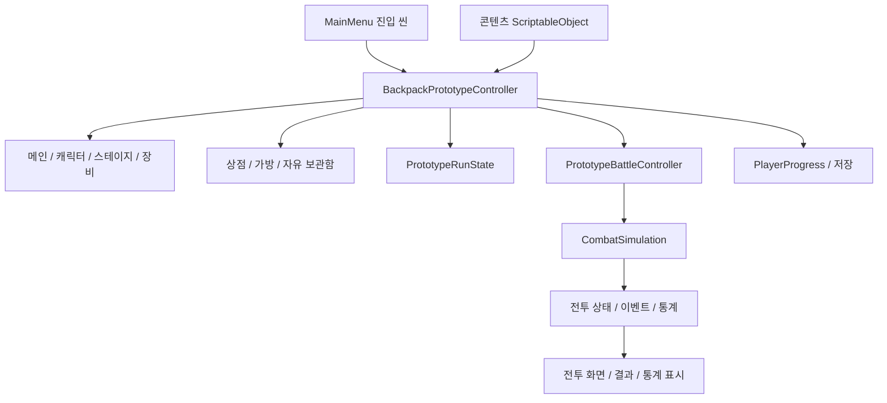

# UI 디자인 착수 분석

분석일: 2026-11-13

후속 확인: 같은 날 진행된 게임 코드 변경으로 준비 화면의 상시 적 요약 패널이 제거되고, `적 정보` 버튼으로 이름·일러스트·체력·6×6 가방을 보는 팝업이 추가되었다. 아래 최초 분석의 적 텍스트 패널 관련 설명은 당시 상태이며, 최신 시안 기준은 [상점 디자인 v2](UI_SHOP_DESIGN_V2.md)를 따른다.

프로젝트의 C# 스크립트, 씬 설정, 데이터 에셋, 기존 문서와 테스트 코드를 읽어 정리했다. Unity를 실행하여 실제 화면이나 동작을 검증한 결과는 아니다. 아래의 **구현됨**은 해당 기능과 화면 구성 코드가 존재한다는 뜻이며, 최종 디자인이나 품질 검증이 끝났다는 뜻은 아니다. 문서와 코드가 다른 경우 현재 코드를 우선했다.

## 1. 현재 상태와 디자인 출발점

이 프로젝트는 가방 배치만 구현된 초기 상태를 넘어, 메인 → 성장/장비 관리 → 스테이지 도전 → 상점/가방 편집 → 자동 전투 → 보상/복귀까지 연결된 프로토타입이다. UI 디자인의 주된 작업은 이미 있는 기능의 정보 구조와 조작 피드백을 정리하고, 공통 시각 규칙을 적용하는 것이다.

- Unity 버전: `6000.3.17f1`.
- 런타임 C# 파일: Core 42개, Prototype 59개. 별도로 Editor 12개, EditMode 테스트 관련 파일 28개, PlayMode 테스트 관련 파일 23개가 있다. 파일 수이며 테스트 케이스 수는 아니다.
- 현재 카탈로그: 캐릭터 2종, 일반 스테이지 5개, 기원의 광산 5개.
- UI 기술: uGUI, Input System, 일부 TextMeshPro. 대부분의 글자는 `UnityEngine.UI.Text`, 아이템 툴팁 설명은 TMP를 사용한다.
- 기준 해상도: 1280×720, CanvasScaler의 `ScaleWithScreenSize / Expand`.
- 화면 구성: 대부분 런타임 `new GameObject`, `RectTransform`, `Image`, `Text`, `Button`으로 생성한다. Assets에서 UI 프리팹·UXML·USS 파일은 발견하지 못했다.
- 입력: 드래그, 호버, 우클릭, R, Shift+우클릭 등 마우스·키보드 중심이다. 우선 PC 가로 화면을 디자인 기준으로 삼는 것이 현재 구현에 맞다. 이는 확정된 출시 플랫폼이 아니라 코드에서 추론한 작업 기준이다.

## 2. 스크립트 구조

| 영역 | 대표 코드 | 역할과 UI 연결점 |
|---|---|---|
| 게임 규칙 | `Core/Inventory/BackpackGrid`, `ItemShape`, `FusionPlanner` | 6×6 배치, 회전, 충돌, 합성 후보 판정. 가방 UI는 판정 결과를 표시한다. |
| 전투 | `Core/Combat/CombatSimulation` 및 partial 파일, `CombatLoadoutSnapshot`, `CombatStatistics` | 자동 전투, 아이템 주기, 상태 효과, 패시브, 피해/회복/방어 통계. View가 전투 규칙을 계산할 필요가 없다. |
| 콘텐츠 정의 | `Core/Items/*Data`, `Core/Stages/*Data`, `Core/Enemies/*Data`, `Core/Shop/*` | 아이템·캐릭터·적·스테이지·상점 확률 정의. 주로 ScriptableObject와 관련 모델이다. |
| 영구 성장/저장 | `Core/Progression/PlayerProgress`, `PlayerProgressStore`, `PlayerEconomy`, `PlayerUniqueGear` | 캐릭터 레벨, 공유 경험치, 파편, 설계도, 티켓, 고유 장비, 스테이지 기록. |
| 전체 흐름 조정 | `Prototype/BackpackPrototypeController`와 8개 partial 파일 | UI 생성, 입력, 준비/전투 전환, 저장 호출, 성장/장비/경제/설정 연결. 파일이 나뉘어 있어도 하나의 클래스다. |
| 런 상태 | `PrototypeRunState`, `PrototypeRunResult` | 이번 도전의 골드·라운드·라이프·종료 판정과 종료 스냅샷. 영구 재화와 구분된다. |
| 전투 표시 조정 | `PrototypeBattleController` | 시뮬레이션 이벤트를 전투 화면에 전달하고 배속·일시정지·통계를 제어한다. |
| 화면/컴포넌트 | `Prototype*Screen`, `*View`, `*Tooltip`, `*Icon`, `*Overlay` | 화면별 표시, 아이템 모양, 상태 아이콘, 툴팁, 합성/피해 연출. |
| 에디터 도구 | `Editor/PrototypeSceneBuilder`, 각종 DataBuilder/Editor | 씬·기본 콘텐츠 생성과 데이터 편집. 플레이어용 UI와 별도다. |

컨트롤러의 partial 파일은 `Combat`, `MainMenu`, `RunLifecycle`, `Gear`, `Economy`, `Settings`, `Fusion`, `PlacementEffects`로 나뉜다.

Core와 Prototype은 asmdef로 구분되어 있고 Prototype이 Core를 참조한다. 다만 Core도 ScriptableObject와 Unity 타입을 사용하므로 Unity와 완전히 독립된 순수 C# 계층은 아니다. 또한 일부 런 규칙은 아직 Prototype 쪽에 있다.

### 씬과 화면의 실제 관계

`MainMenu.unity`는 메인 화면을 배치한 씬이 아니라 진입용 씬이다. `PrototypeMainMenuEntry`가 메인 진입 요청을 남기고 `Prototype_Backpack`을 로드한다. 이후 `BackpackPrototypeController.Awake()`가 전체 UI를 생성하고 메인을 표시한다. 개발자가 `Prototype_Backpack`을 직접 실행하면 준비 화면부터 시작한다.

따라서 디자인 대상인 메인·캐릭터·장비·상점·전투 화면을 각각 별도 Unity 씬이라고 생각하면 안 된다. 현재는 공통 씬 안에서 화면 루트를 켜고 끈다.

### UI 교체에 유리한 연결점

- `TryStartRun`, `TryStartBattle`, `TryRerollShop`, `TrySelectCharacter`, `TryLevelUpCharacter`, `TryEquipUniqueGear` 등의 기존 동작을 새 버튼에 연결할 수 있다.
- 전투용 가방은 준비 화면의 가방을 이동해 쓰는 방식이 아니라 스냅샷으로 별도 표시한다. 편집 가능한 가방과 읽기 전용 전투 가방의 역할을 유지한다.
- `ItemTooltipContent`와 `StatusTooltipContent`가 표시 내용을 제공한다. 특히 전투 툴팁은 원본 수치와 실제 전투 수치를 구분한다.
- `RunEnded`, `RestartRequested`가 종료/재시작 연결점으로 존재한다.
- 다만 View가 컨트롤러 및 정적 UI 생성 함수에 직접 의존하는 부분이 많다. 이미 완전한 MVC/MVP 구조로 분리되어 있는 것은 아니다.

## 3. 필요한 화면 목록

우선순위는 **디자인/구현 순서**다. P0는 핵심 반복 플레이와 공통 기반, P1은 메타 성장과 전체 흐름 완성, P2는 후속 사용성 확장이다. 기존 기능을 삭제하거나 출시 범위에서 제외한다는 뜻은 아니다.

### 주요 화면

| ID | 화면 | 반드시 다룰 정보·조작 | 현재 상태 | 우선순위 |
|---|---|---|---|---|
| S01 | 메인/로비 | 선택 캐릭터·레벨·체력/공격력, 선택 스테이지/기록, 시작, 종료 | `PrototypeMainMenuScreen` 구현 | P1 |
| S02 | 공통 메인 내비게이션 | 장비·캐릭터·메인·스테이지 탭, 경험치, 파편, 티켓 수/충전 시간, 설정 | `PrototypeMainNavigation` 구현. 재화 호버 시 정확한 값 표시 | P1 |
| S03 | 캐릭터 선택/성장 | 캐러셀, 미리보기, 스탯, 장비 슬롯, 패시브, 레벨업 비용, 출전 선택/취소 | `PrototypeCharacterCarousel.cs`에 선택 화면까지 구현 | P1 |
| S04 | 스테이지 선택 | 일반/광산 구분, 해금·클리어·최고 기록, 적/보스, 보상, 선택, 광산 소탕 | `PrototypeSelectionScreens.cs` 구현 | P1 |
| S05 | 고유 장비 관리 | 캐릭터 스탯, 장착 3슬롯, 보유 목록, 종류 필터, 제작 목록, 잠금 모드, 분해 진입 | `PrototypeEquipmentScreen` 구현 | P1 |
| S06 | 전투 준비 | 상점 4슬롯, 골드, 할인/잠금/구매 완료, 리롤, 6×6 가방, 자유 보관함, 판매, 다음 적, 전투 시작, 포기 | 컨트롤러 `BuildShop/BuildStorage`, `PrototypePreparationPanel`, 각 ItemView 구현 | P0 |
| S07 | 자동 전투 | 양측 가방·캐릭터·HP·방어도·회피율·상태·패시브, 쿨타임, 피해 표시, 시간, 라이프, 배속/일시정지 | `PrototypeBattleScreen`, `BattleBagView`, `StatusArea` 등 구현 | P0 |
| S08 | 라운드 승패 | 승패 사유/라이프 변화, 다음 라운드 또는 같은 라운드 재도전, 통계 | 전투 화면 내부 상태로 구현. 독립 전체 화면일 필요는 없음 | P0 |
| S09 | 런 최종 결과 | 클리어/게임 오버, 스테이지, 도달 라운드, 승패 횟수, 누적 시간, 보상, 재시작/메인/통계 | `PrototypeRunResultScreen` 구현 | P0 |
| S10 | 전투 통계 | 플레이어/적, 공격/방어 탭, 아이템별 누적 막대, 상세 내역, 합계, 빈 기록, 닫기 | `PrototypeCombatStatisticsView` 구현. 직전 전투 통계 | P0 |

### 팝업·설정·설명 UI

| ID | UI | 필요한 상태/내용 | 현재 상태 | 우선순위 |
|---|---|---|---|---|
| O01 | 아이템 툴팁 | 이름·등급·분류·공격 관련 수치·효과, 효과 전용 아이템의 축약 배치, 현재 수치 증감, 화면 가장자리 처리 | `PrototypeItemTooltip`, `ItemTooltipContent` 구현 | P0 |
| O02 | 상태/패시브/재화 설명 | 효과, 중첩, 정확한 재화량, 현재 광폭화 증가율 | `StatusTooltipContent`, `PrototypePassiveIcon`, `PrototypeCurrencyHover` 등 구현 | P0/P1 |
| O03 | 장비 상세/강화 | 장착/해제, 등급·강화 수치·효과, 소유 캐릭터, 강화 비용, 사용 불가 상태 | 장비 화면과 고정 툴팁 조합으로 구현 | P1 |
| O04 | 장비 이동 확인 | 다른 캐릭터가 장착 중인 장비를 옮길 때 대상과 영향 표시 | 장비 화면 내부 확인 모달 구현 | P1 |
| O05 | 제작 상세 | 결과 장비, 파편/설계도 필요량과 보유량, 제작/부족 상태 | 장비 화면 내부 구현 | P1 |
| O06 | 승급 재료 선택 | 승급 결과, 재료 2칸, 사용 가능/불가능 후보, 선택 수, 확정/취소 | `PrototypePromotionScreen` 구현 | P1 |
| O07 | 다중 분해 | 선택 장비, 선택 수, 예상 반환 파편/설계도, 장착/잠금 제외, 확정/취소 | `PrototypeDismantleScreen` 구현 | P1 |
| O08 | 소탕 보상 | 획득 보상, 확인 | `PrototypeRewardPopup` 구현 | P1 |
| O09 | 설정 | 전체/음악/효과음, 해상도/화면 모드, 기본 배속, 피해 숫자, 탭별 기본값 복원 | `PrototypeSettingsScreen` 구현 | P1 |
| O10 | 해상도 변경 확인 | 유지/되돌리기, 15초 카운트다운 | 설정 내부 구현 | P1 |
| O11 | 스테이지 포기 확인 | 보상 포기 안내, 확정/취소 | `BackpackPrototypeRunLifecycle` 내부 구현 | P0 |
| O12 | 공통 짧은 피드백 | 골드 부족, 배치/회전 실패, 구매·판매 등 꼭 필요한 행동 결과 | 일부 화면별 오류 문구는 있지만 공통 알림 시스템은 없음. `SetStatus`는 Console 로그만 기록 | P0 보완 |
| O13 | 첫 플레이 도움말 | 구매/배치/판매, 회전, 잠금의 차이, 보관함과 합성 시점 | 정적 조작 안내는 있음. 단계별 튜토리얼/도움말 화면은 확인하지 못함 | P2 신규 |

### 별도 화면이 아닌 공통 컴포넌트

- 버튼: 기본/호버/누름/선택/비활성. 중요한 실행 버튼, 일반 버튼, 포기·분해 버튼의 구분.
- 패널·탭·스크롤 목록·모달 배경·닫기/뒤로 버튼.
- 아이템 시각: 다중 칸 모양, 등급, 장착, 강화 수치, 가격·할인, 잠금 배지.
- 가방: 빈 칸, 점유 칸, 선택/드래그, 배치 가능/불가, 배치 효과 대상, 합성 후보·합성 잠금.
- 전투: HP/방어도, 라이프 하트, 상태 아이콘·중첩, 쿨타임 채움, 피해 숫자, 활성화 강조.
- 경제: 경험치·파편·설계도·티켓·런 골드의 아이콘과 수량/비용 표시.
- 안내: 빈 목록, 부족한 재화, 잠긴 콘텐츠, 데이터 오류, 저장 실패, 합성 중 입력 제한.

## 4. 디자인 시 반드시 보존할 게임 규칙

1. **런 골드와 영구 재화가 다르다.** 상점의 골드는 도전 내 재화다. 메인의 경험치·파편·설계도·티켓과 동일한 지갑처럼 표시하지 않는다.
2. **HP와 라이프가 다르다.** 전투 패배 시 라이프가 줄어든다. 생존 시 같은 라운드로 돌아오며 골드와 아이템을 유지하고 추가 수입/무료 리롤을 주지 않는다.
3. **세 잠금의 의미가 다르다.** 상점 잠금은 리롤/라운드 갱신에서 상품 유지, 합성 잠금은 자동 합성 제외, 고유 장비 잠금은 분해/승급 재료 사용 방지다. 같은 자물쇠를 쓰더라도 문구·위치·부가 표식을 구분한다.
4. **자유 보관함은 전투 가방이 아니다.** 보관함 아이템은 전투에 참여하지 않는다. 현재는 자유 좌표·겹침 허용·개수 제한 없음이며, 일반 슬롯형 인벤토리로 바꾸면 동작 변경이 된다.
5. **합성은 즉시 구매 기능이 아니다.** 전투 시작 때 합성 후보를 예약하고, 상점 복귀 시 재료를 소모해 결과를 보관함으로 보낸다. 최종 클리어/게임 오버에서는 실행하지 않는다. 준비 화면에서 예상 결과와 실행 시점을 읽을 수 있게 한다.
6. **고유 장비에는 별도 규칙이 있다.** 출전 장비는 가방/보관함 이동과 회전이 가능하지만 스테이지 상점 판매와 합성은 불가하다. 영구 장비 목록과 이번 런의 복사본을 혼동하지 않게 한다.
7. **캐릭터 미리보기와 선택 확정이 다르다.** 레벨업은 미리보는 캐릭터에 적용하며 출전 캐릭터는 선택 버튼으로 확정한다.
8. **광산 티켓은 클리어 때 차감한다.** 입장에는 티켓이 필요하지만 패배·포기로 차감하지 않는다. 소탕은 보상 지급과 함께 차감한다. 버튼에 ‘입장 즉시 소모’처럼 오해할 문구를 쓰지 않는다.
9. **전투 시간과 실제 시간이 다르다.** 배속은 전투 시계에만 적용한다. 60초부터 광폭화, 90초 강제 패배가 있다. 전투 시간·위험 상태·패배 사유의 표시를 일관되게 한다.
10. **전투 통계는 직전 전투 기준이다.** 최종 결과의 누적 전투 시간과 전투 통계 막대의 집계 범위를 구분한다. UI의 통계 분류는 공격/방어이며 회복 내역은 방어 쪽에 포함된다.
11. **진행 중 런 이어하기는 없다.** 캐릭터/스테이지 선택, 성장, 장비, 기록을 저장한다. 현재 동작을 유지한다면 ‘이어하기’ 버튼은 설계 범위에 넣지 않는다.

## 5. 현재 구조에서 먼저 해결할 디자인 문제

| 관찰한 사실 | 디자인/구현에 주는 의미 | 제안 |
|---|---|---|
| 색상·폰트 크기·좌표가 여러 생성 함수에 직접 들어 있음 | 화면별 스타일 수정이 반복되고 쉽게 달라짐 | 공통 Theme와 UI 생성/프리팹 규칙을 먼저 정의 |
| 1280×720 기준 고정 크기·좌표가 많음 | CanvasScaler가 있어도 긴 한글·다른 화면비의 배치를 보장하지 않음 | 기준 화면의 정보 우선순위를 정하고 대표 화면비에서 확인 |
| 일반 Text와 TMP 설명이 혼용됨 | 글꼴/줄바꿈/숫자 정렬 차이가 날 수 있음 | 한글 글꼴과 크기 체계 확정, TMP 확대 적용은 화면 단위로 진행 |
| `SetStatus`가 Debug.Log만 출력함 | 구매/배치 실패의 구체적인 이유를 사용자가 놓칠 수 있음 | 부족 비용·배치 불가 등 필요한 실패 피드백을 인접 문구나 짧은 알림으로 추가 |
| 준비 화면의 다음 적이 텍스트 위주임 | 상점 구매와 배치 판단에 필요한 정보를 빠르게 비교하기 어려울 수 있음 | 적 요약 카드에 핵심 위협·HP·보스 여부를 우선 배치 |
| 우클릭/Shift 조합에 여러 기능이 있음 | 안내를 읽지 않으면 잠금과 회전을 발견하기 어려움 | 상황별 조작 힌트/설명, 잠금 종류별 명칭을 통일 |
| 화면 전환과 모달 순서를 개별 SetActive/SetAsLastSibling으로 제어 | 새 팝업 추가 시 배경 입력·툴팁 우선순위가 흔들릴 여지 | 닫기/ESC/배경 입력/일시정지 규칙을 공통화 |
| 개발용 라운드 건너뛰기가 현재 씬에서 켜져 있음 | 시안에 테스트 버튼을 제품 기능으로 포함할 수 있음 | 제품 시안에서 개발 전용 요소를 제외하고 QA에서만 활성화 |

이 항목들은 모두 실제 화면의 시각적 결함을 확인했다는 의미가 아니다. 코드 구조상 디자인 단계에서 확인하거나 개선할 지점이다. 일부 기존 문서는 현재 UI보다 오래되어, 예를 들어 결과 요약의 남은 라이프와 전투 일러스트 설명은 코드와 다를 수 있다.

## 6. 권장 진행 순서

### 1단계: 화면 흐름과 상태 정의

- 우선 기준: PC 마우스/키보드, 가로 16:9, 현행 1280×720 논리 좌표. 실제 출시 플랫폼·최소 해상도는 디자인 착수 시 확정할 항목으로 남긴다.
- 화면 S01~S10과 팝업 O01~O13의 관계를 정리한다.
- 기본/호버/선택/비활성뿐 아니라 실패·빈 목록·잠김·합성 진행·일시정지 상태를 정의한다.
- 전투 승리 → 다음 라운드, 생존 패배 → 같은 라운드, 종료 → 보상/메인의 버튼과 문구를 확정한다.
- 산출물: 화면 흐름도 + 화면/상태 목록.

### 2단계: 핵심 플레이 와이어프레임

가장 먼저 **준비 화면 1장, 전투 화면 1장, 결과·통계 연결 흐름**을 만든다. 준비 화면에는 상점·가방·보관함·적 정보·툴팁·행동 버튼이 모여 있어 공통 디자인을 검증하기 좋다.

- 준비 화면 초안: 상단 라운드/골드/라이프 → 왼쪽 상점 → 중앙의 가장 중요한 가방 → 오른쪽 다음 적/전투 시작 → 하단 보관함.
- 보관함에는 전투 미참여를 명시하고, 판매 영역은 드래그할 때 분명하게 드러낸다.
- 전투는 좌우 대응 구조를 유지하되 HP·상태·쿨타임을 먼저 읽고, 상세 수치와 로그는 필요할 때 확인하도록 정보 비중을 조절한다.
- 와이어프레임에는 실제 아이템 이름, 긴 설명, 큰 재화 수량을 넣는다.
- 산출물: 기본/드래그/툴팁/재화 부족/패배 상태를 포함한 저해상도 시안.

### 3단계: 시각 스타일과 공통 부품

기존 캐릭터 아트 문서의 차분한 판타지 색감과 선명한 윤곽을 참고해 **어두운 청회색 바탕 + 절제된 금속/가죽 프레임 + 밝고 읽기 쉬운 한글**을 시작안으로 제안한다. 확정 스타일은 아니다. 캐릭터가 픽셀 표현이라고 해서 모든 작은 글자와 조작 요소까지 픽셀 폰트로 만들 필요는 없다.

- 버튼·패널·탭·아이템 카드·툴팁·상태 아이콘·모달을 하나의 스타일로 만든다.
- 색상은 희귀도, 행동 가능 여부, 위험, 선택 상태의 역할이 충돌하지 않게 배분한다. 의미는 색상과 함께 아이콘/문구로도 전달한다.
- 글자 크기·행간·간격·테두리·강조·애니메이션 시간의 공통값을 정한다.
- UI 이미지가 필요할 때 공통 패널/버튼 프레임, 아이콘 세트부터 제작한다. 값과 문구는 게임 UI에서 렌더링한다.
- 산출물: 공통 컴포넌트 시트 + 준비/전투의 완성도 높은 대표 시안.

### 4단계: Unity에서 한 흐름 완성

현재 uGUI 구조를 활용하여 준비 → 전투 → 결과 한 흐름에 먼저 적용한다. UI 디자인 적용을 위해 전체 프레임워크나 씬 구조를 먼저 교체할 필요는 없다.

권장 분리:

- `UITheme`: 색상·글꼴·크기·간격 등 공통 정의.
- 화면 View/프리팹: 배치·이미지·글자·클릭 이벤트.
- Presenter 또는 기존 컨트롤러 연결부: 상태를 읽어 View 갱신, 사용자 동작을 기존 Try 메서드로 전달.
- 게임 모델: 배치·전투·성장·저장 규칙 유지.

처음에는 기존 생성 함수를 Theme에 연결하고, 안정된 공통 부품과 화면부터 프리팹으로 옮기는 점진적 방법을 권한다. 드래그 판정의 셀 간격/크기와 시각적 셀 크기를 함께 관리하고, 기존 Grid 좌표 변환을 새 레이아웃에서 확인한다.

### 5단계: 메인·성장·설정으로 확장

공통 부품이 검증되면 메인 → 캐릭터 → 스테이지 → 장비/제작/강화/승급/분해 → 설정 순서로 확장한다. 장비는 상태와 모달이 많으므로 재사용할 카드·상세 창·확인 창이 잡힌 뒤 적용하는 편이 효율적이다.

### 6단계: 실제 입력과 화면 검증

- 1280×720, 1920×1080, 지원 예정인 다른 화면비에서 한글 줄바꿈·겹침·툴팁 경계를 확인한다.
- 드래그 구매/판매/회전/취소, 잠긴 상품 유지, 보관함 이동, 합성 결과 이동을 확인한다.
- 같은 라운드 재도전, 최종 결과, 메인 복귀, 설정의 전투 정지/복원을 확인한다.
- 빈 장비 목록, 재화 부족, 잠긴 스테이지, 티켓 0, 장비 잠금/장착, 저장 실패 문구를 확인한다.
- 변경 범위에 맞는 기존 EditMode/PlayMode 테스트를 실행한다. 배치·상점 잠금·합성·레이아웃·툴팁·전투 재생·런 생명주기·메인/설정 테스트가 이미 있다.
- 일부 PlayMode 테스트는 오브젝트 이름이나 RectTransform 배치에 의존한다. 의도한 디자인 변경에 맞춰 위치 검증을 갱신하되 게임 동작 검증은 유지한다.

## 7. 첫 디자인 작업의 구체적 범위

첫 작업은 **전투 준비 화면의 와이어프레임**으로 잡는 것이 적합하다.

완료 조건:

1. 무엇을 살 수 있는지, 얼마가 남았는지, 어디에 놓을 수 있는지 읽힌다.
2. 전투에 쓰는 가방과 자유 보관함을 구분할 수 있다.
3. 다음 적을 보고 배치를 판단하고 전투를 시작할 수 있다.
4. 툴팁을 띄우거나 아이템을 드래그해도 주요 조작을 방해하지 않는다.
5. 구매 불가·배치 실패·잠금·합성 예정의 의미를 이해할 수 있다.

기본 상태 외에 **아이템 드래그, 툴팁 표시, 골드 부족, 합성 예정**까지 함께 설계한다. 이후 전투 화면에 같은 아이템/상태/글자 규칙을 적용하면 나머지 화면의 기준도 정해진다.

## 8. 주요 근거 파일

경로는 프로젝트 루트 기준이다.

- `ProjectSettings/ProjectVersion.txt`, `ProjectSettings/EditorBuildSettings.asset`
- `Assets/Scenes/MainMenu.unity`, `Assets/Scenes/Prototype_Backpack.unity`
- `Assets/_Project/Scripts/Prototype/PrototypeMainMenuEntry.cs`
- `Assets/_Project/Scripts/Prototype/BackpackPrototypeController.cs` — Awake, BuildInterface, BuildShop, BuildStorage, SetStatus
- `Assets/_Project/Scripts/Prototype/BackpackPrototypeMainMenu.cs`
- `Assets/_Project/Scripts/Prototype/BackpackPrototypeCombat.cs`
- `Assets/_Project/Scripts/Prototype/BackpackPrototypeRunLifecycle.cs`
- `Assets/_Project/Scripts/Prototype/BackpackPrototypeEconomy.cs`, `BackpackPrototypeGear.cs`, `BackpackPrototypeFusion.cs`
- `Assets/_Project/Scripts/Prototype/PrototypeRunState.cs`, `PrototypeBattleController.cs`
- 화면 목록에 기재한 각 Screen/View와 `Assets/_Project/Tests/PlayMode/*`
- `Docs/MAIN_MENU.md`, `Docs/RUN_LIFECYCLE.md`, `Docs/DEVELOPMENT_START.md`, `Docs/Art/CHARACTER_ART_STYLE.md`

이번 분석에서는 게임 스크립트·씬·데이터를 변경하지 않았다.
